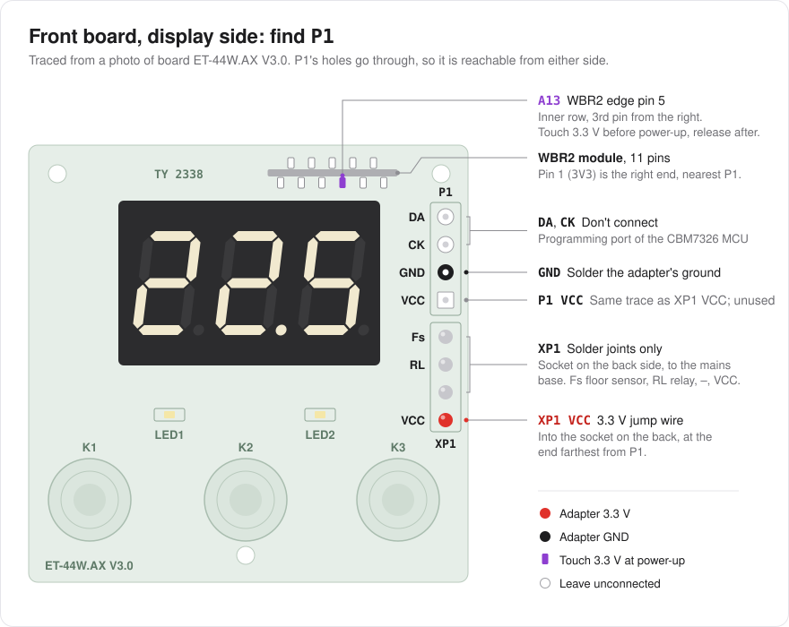
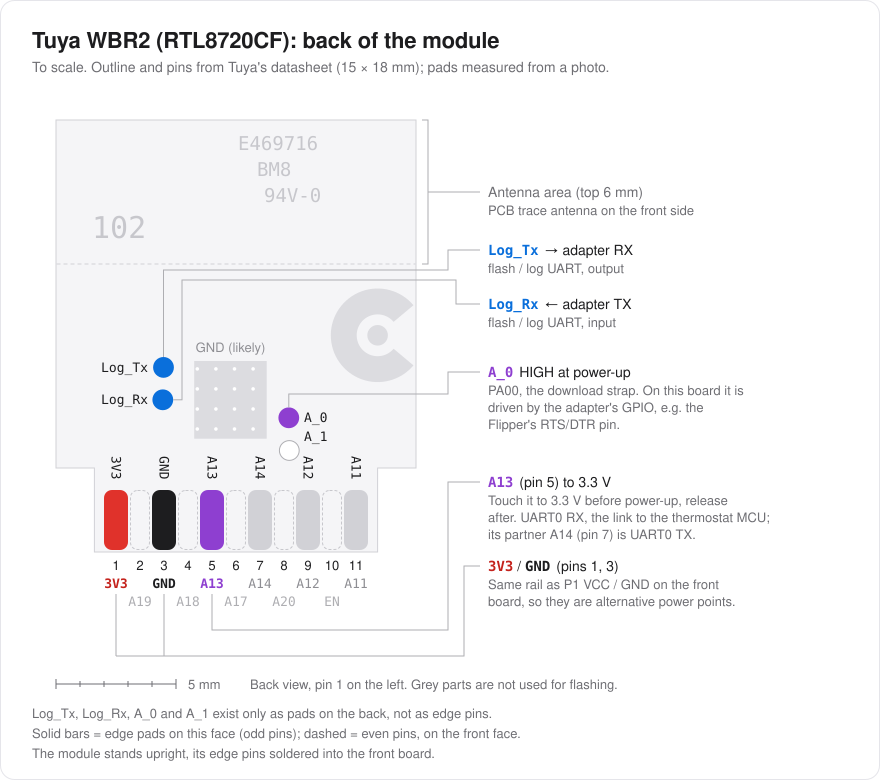
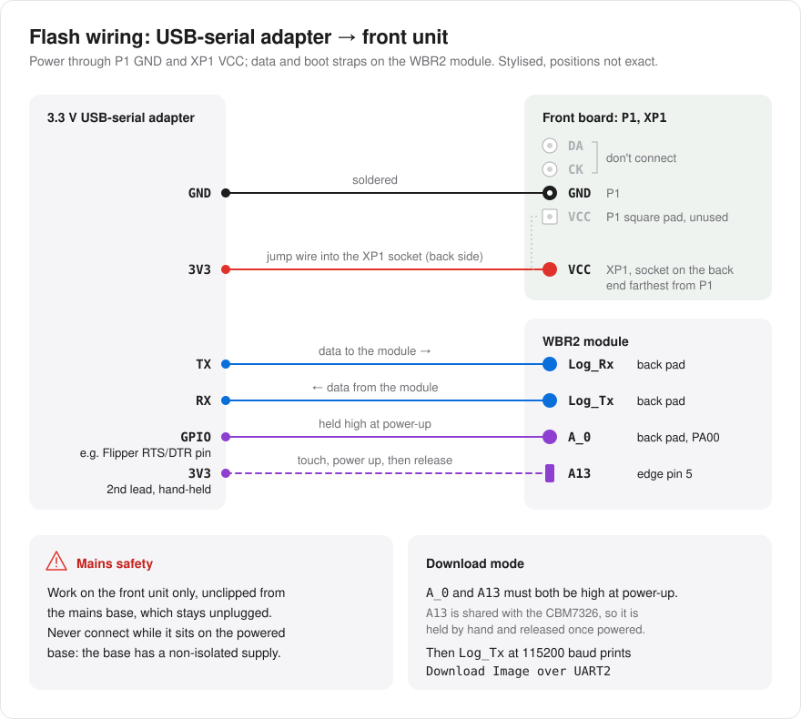

# ET-44W hardware and first flash

Tested on two ET-44W floor thermostats (sold as Warmee and EXTHERM; board marked `TY 2338`, silkscreen
`ET-44W.AX V3.0`) with a Tuya **WBR2** Wi-Fi module (Realtek **RTL8720CF**, "AmebaZ2"; module label
`2.01.99.00008`). Other boards with a WBR2 and a separate thermostat MCU are likely similar, but check
the pads first.

> **Mains safety.** The base in the wall box has a non-isolated power supply. Flash only the **front unit**,
> unclipped from the base, powered from your 3.3 V USB-serial adapter. Never connect a computer to the unit
> while it sits on the powered base.

## Board

- **Base** (wall box): fuse, 16 A relay (12 V coil, `QY32F-012DC`), non-isolated PSU, 4-pin header `XP2`.
- **Front unit** (unclips by hand, no mains on it): the thermostat MCU `IC1` = Chipsbank **CBM7326FLG**
  (keys, display, relay, schedule) and the WBR2 module `W1`, mounted upright. The MCU talks to the module
  over **TuyaMCU** on the module's UART0 (A13 RX / A14 TX, 9600 baud). The front board has no regulator:
  one 3.3 V rail comes from the base through `XP1` (`Fs / RL / – / VCC`).
- `P1` (`DA / CK / GND / VCC`) is the CBM7326's programming port, **not** the module's. `DA` and `CK` go to
  the thermostat MCU and must stay unconnected. Its `GND` is the easy ground point for flashing.
- `XP1` is a female 2.54 mm socket on the **back** of the board, where the base plugs in; on the display side
  you only see its four joints (`Fs / RL / – / VCC`, below P1). Its `VCC` (the end farthest from P1) and P1's
  `VCC` (the square pad) are the same trace: the 3.3 V rail that also feeds the module's `3V3` pin. The
  3.3 V jump wire plugs into XP1's `VCC` position.



### WBR2 pins

Edge pins (soldered into the front board), per Tuya's datasheet:

| Pin | 1 | 2 | 3 | 4 | 5 | 6 | 7 | 8 | 9 | 10 | 11 |
|---|---|---|---|---|---|---|---|---|---|---|---|
| | 3V3 | A19 | GND | A18 | A13 (UART0 RX) | A17 | A14 (UART0 TX) | A20 | A12 | EN | A11 |

The flashing UART and the boot strap exist **only as test pads on the back of the module**:
`Log_Tx`, `Log_Rx`, `A_0` (PA00, download strap), `A_1`.



## Download mode



1. Connect a 3.3 V USB-serial adapter: adapter RX → `Log_Tx`, adapter TX → `Log_Rx`, GND → `P1` `GND`
   (soldered wire), 3.3 V → `XP1` `VCC` (jump wire plugged into the socket on the back, the end farthest from P1). Leave `P1` `DA` and `CK` unconnected.
2. Hold **`A_0` high (3.3 V)** at power-up. On this board **`A13` must also be held high**, because the
   CBM7326 shares the line and pulls it otherwise (same fix as LibreTiny issue #235): touch a 3.3 V wire
   to the module's `A13` edge pin (pin 5: seen from the display side, the 3rd pin from the right in the row
   next to the display) **before** you power the board, keep it there while power comes
   on, then release it.
3. Power-cycle. Success looks like this on `Log_Tx` at 115200 baud:
   `Download Image over UART2[tx=16,rx=15] baud=115200`.
   `[SPIF Err]Invalid ID` / `Invalid RAM Img Signature` means the UART was ignored: check `A13`.
   A normal Tuya boot means `A_0` wasn't high.

Pogo pins on the three pads work; thin soldered wires (removed afterwards) are more reliable.
We used a Flipper Zero in USB-UART bridge mode, with its RTS/DTR pin holding `A_0` high (set "RTS/DTR
Pins" in the bridge config, and open the serial port without asserting RTS/DTR so the pin stays high).
Any 3.3 V adapter with a spare control pin works, or a jumper wire from `A_0` to 3.3 V.

## Back up the stock firmware first

The stock image holds the device's Tuya keys and your Wi-Fi credentials (it also prints the Wi-Fi
password on `Log_Tx` at every boot). Keep the dump private, but keep it: it's the only way back.

```sh
python3.12 -m venv .venv-flash && .venv-flash/bin/pip install ltchiptool typer construct pycryptodomex pyserial cryptography
.venv-flash/bin/python scripts/ambz2_dump.py stock.bin          # ~17 min for 2 MiB; verifies SHA-256 on the chip
.venv-flash/bin/python scripts/ambz2_write.py stock.bin --verify-only
```

Use Python 3.10 or newer for the venv (ltchiptool needs it; macOS's `/usr/bin/python3` is 3.9).
The dump, write and boot-log scripts pick the USB-serial port themselves when exactly one
(`/dev/cu.usbmodem*`, `/dev/ttyACM*`, `/dev/ttyUSB*`) is present; pass `--port <path>` to choose
another. `typer`, `construct` and `pycryptodomex` are imported by ltchiptool's AmbZ2 image code (the
build and `scripts/ambz2_split.py` need them); `cryptography` signs OTA images
(`firmware/tools/ota_keygen.py`, `ota_push.py`). `scripts/ble_btp_check.py`, a host-side check for
the `libs/ble-probe` BLE test build, also needs `pip install bleak`.

`scripts/ambz2_dump.py` and `scripts/ambz2_write.py` exist because ltchiptool's own read/write
uses large chunks and short timeouts that fail through slow USB-UART bridges: they move 4 KiB
(read) / 64 KiB (write) at a time with long timeouts and retries, and compare a chip-side SHA-256.
`scripts/ambz2_split.py` splits a dump into partitions. Stock layout: partition table @0x0,
bootloader @0x4000, FW1 @0x10000, FW2 @0xF0000, Tuya KV @0x1D0000 (nothing encrypted, secure boot off).

## First flash, then Wi-Fi updates

Build (see the README), then write the full image that also wipes the old Tuya data:

```sh
.venv-flash/bin/python scripts/ambz2_write.py firmware/out/image_flash_wipe.0x000000.bin
```

After that, updates go over Wi-Fi (`firmware/tools/ota_push.py`), Ed25519-signed with your own key,
with automatic rollback if the new image doesn't come up healthy. The wires can come off once an
over-the-air update has worked on that unit. To go back to stock, write your dump with
`ambz2_write.py`.

## Data points (TuyaMCU)

Temperatures are tenths of °C. Product id of the stock firmware: `gc1bxoq2hafxpa35`.

| DP | Code | Access | Meaning |
|---|---|---|---|
| 1 | switch | rw | on/off |
| 2 | mode | rw | raw enum: holiday 0, smart (weekly program) 1, hold (manual) 2 |
| 3 | work_state | ro | raw: idle at setpoint 0, heating (relay on) 1 |
| 16 / 17 | temp_set / _f | rw | target, 5.0–40.0 °C step 0.5 / °F |
| 24 / 29 | temp_current / _f | ro | temperature of the selected sensor |
| 104 | SensorError | ro | bitmap: bit0 room, bit1 floor sensor fault |
| 107 | TemperUnitChange | rw | °C/°F display |
| 108 | Lock | rw | child lock |
| 109 | TimeHoliday | rw | holiday duration 0–99 |
| 110 | Event_Adaptive_Set | rw | adaptive start, 0–100 (meaning unconfirmed) |
| 111 | SemChange | rw | sensor selection 0/1/2 (mapping unconfirmed) |
| 112 / 113 | Room/FloorTemperComp | rw | calibration −90…90 (tenths of °C) |
| 114 | TemperDiff | rw | hysteresis 0.5/1/2/3 °C (raw 0–3) |
| 115 | Reset | w | **factory reset: never send** (the firmware's allowlist blocks it) |
| 116 | PowerSet | rw | configured heater power, W |
| 117 | HeaterTime | ro | cumulative heating time counter |
| 119 | week_program | rw | weekly schedule, one report per day (below) |
| 121 | FloorLimit | rw | floor temperature limit, 200–1220 (scale unconfirmed) |
| 122 | inquire | w | request a status refresh |

DP119 day record (21 bytes): day mask (one bit, 0x01 = Monday … 0x40 = Sunday), then 4 periods of
`[index, hour, minute, temperature ×10 as big-endian 16-bit]`. The write format is not yet verified,
so the firmware keeps DP119 read-only.
